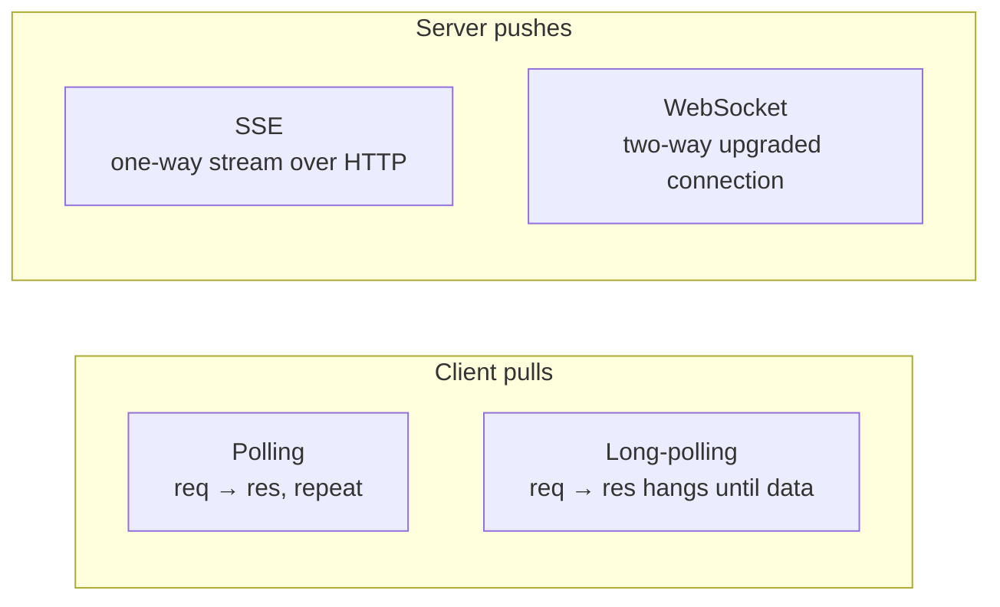

# SSE vs the Alternatives

Four ways to get "live" data in a browser. Here's when each wins.

## The contenders



## Polling

Client fires `fetch()` every N seconds. Each request is a complete,
independent HTTP round-trip.

```js
setInterval(async () => update(await (await fetch("/state")).json()), 5000);
```

- ✅ Dead simple; stateless; every cache/proxy/CDN in the world helps you
- ✅ Perfectly fine when "live" means "within a minute"
- ❌ Latency = half your interval, on average
- ❌ Wasteful: most responses carry no new data; headers cost ~1KB per poll

**Verdict:** the right default until you genuinely need <1s freshness.

## Long-polling

Client requests; server *holds* the request open until data is ready (or a
timeout ~30s), then responds; client immediately re-requests.

- ✅ Near-real-time latency with plain request/response semantics
- ✅ Works through the fussiest proxies
- ❌ Every event is a full HTTP round-trip (headers again)
- ❌ Complicated server state (held connections, timeout races, the gap
  between response and next request can lose events)
- ❌ Largely obsoleted by SSE — it was the pre-2010 workaround

## SSE

- ✅ Real push, minimal overhead (a few bytes per event, zero per-poll headers)
- ✅ Auto-reconnect + `Last-Event-ID` built in
- ✅ Plain HTTP — no upgrade, works over HTTP/2, easy to debug with `curl -N`
- ✅ Native browser API, zero deps
- ❌ One direction only (client talks back via normal fetch — fine for most
  apps)
- ❌ Text only; HTTP/1.1's 6-connections-per-origin limit
- ❌ No IE support

## WebSocket

A real TCP-like socket tunneled through an HTTP upgrade — full duplex, binary
capable, sub-millisecond in both directions.

- ✅ Client → server streaming (games, collab editing, typing indicators)
- ✅ Binary frames
- ✅ Lowest latency both ways
- ❌ A different protocol after the upgrade: proxies, LBs, and middleware that
  understand HTTP may not handle it; debugging needs `wscat`, not `curl`
- ❌ No built-in reconnect/resume — you build all of it (or use Socket.IO)
- ❌ Doesn't ride HTTP/2 the same way; each socket is its own connection
- ❌ Heavier: stateful protocol machinery for what is often a read-only feed

## The decision table

| Need | Best tool |
| ---| --- |
| Updates every ~30s+ are fine | **Polling** — don't over-engineer |
| Live server→client feed, browser UI | **SSE** — the sweet spot |
| LLM token streaming, build logs, dashboards | **SSE** |
| Client also streams (input, cursor, presence) | **WebSocket** |
| Binary payloads | **WebSocket** |
| Must survive hostile corporate proxies | Long-polling or SSE (test!) |
| Mobile app (battery matters) | SSE over HTTP/2, or FCM/APNs |

## The honest trade-off sentence

!!! quote ""
    SSE gives you **90% of WebSocket's value for 10% of its complexity** — as
    long as your data flows one way. The moment the client needs to *stream*
    back, graduate to WebSockets without regret.

A common production pattern: **SSE for the read path, `fetch()` POSTs for the
write path** — which is exactly what this demo's chat does.

## Check your understanding

<quiz>
Dashboard refreshes every 60s and nobody minds slower. Pick:
- [x] Plain polling — don't over-engineer
- [ ] SSE — always better than polling
- [ ] WebSocket — real-time is real-time
- [ ] Long-polling — best of both

At minute-scale freshness, a persistent connection buys nothing and costs
operational complexity.
</quiz>

<quiz>
Multiplayer game needs cursor positions from every client 30×/sec. Pick:
- [ ] SSE
- [x] WebSocket
- [ ] Polling at 33ms intervals
- [ ] Long-polling

The client needs to *stream* — SSE is receive-only. This is the clean
WebSocket case.
</quiz>

<quiz>
The standard production pattern for "read live + write sometimes" is…
- [ ] WebSocket both ways, always
- [x] SSE for reads + ordinary `fetch()` POSTs for writes
- [ ] Two EventSource connections
- [ ] Polling writes, SSE reads

Exactly what this demo's chat does — each transport does what it's best at.
</quiz>

Next: [run the demo](../build/quickstart.md).
