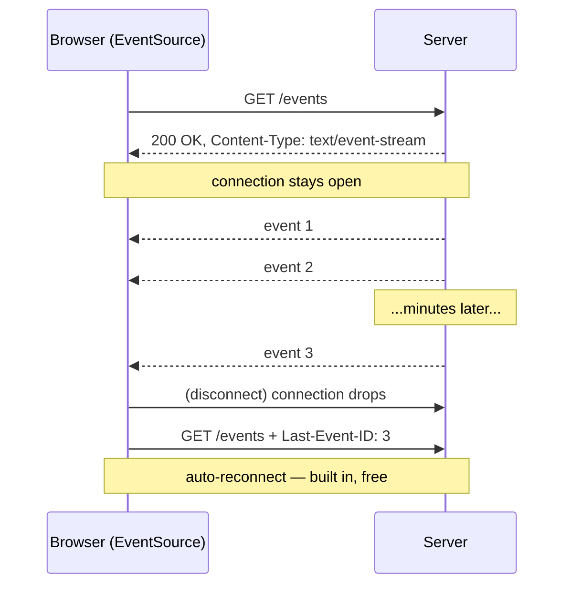

<!-- markdownlint-configure-file {"MD033": {"allowed_elements": ["quiz"]}} -->

# What is Server-Sent Events?

## The problem it solves

You have data on a server that changes over time — a stock price, a build log,
a delivery driver's location, an LLM's tokens. The user wants to see updates
*as they happen*.

One option is **polling**: the browser repeatedly asks whether anything changed.
That is fine for occasional updates. For frequent updates, SSE lets the server
send new data when it is ready, without waiting for another request.

SSE is still ordinary HTTP. The difference is that the response stays open;
an ordinary completed response does not necessarily close its underlying connection.

## The idea in one sentence

!!! quote ""
    **Let the client's request stay open, and let the server keep writing to it.**

The browser sends a normal `GET /events`. Instead of sending a body and
finishing, the server sends `Content-Type: text/event-stream` and then *keeps
the response open*, appending a small text record every time something
happens. The browser parses each record and fires a JavaScript event.
The stream can end or drop; EventSource normally reconnects automatically.



## Key properties

| Property | What it means |
| --- | --- |
| **One direction** | Server → client only. The client talks back with ordinary `fetch()` calls. |
| **One connection** | All events for a page share a single long-lived HTTP connection. |
| **Text only** | UTF-8 text frames. Binary must be encoded (e.g. base64). |
| **Auto-reconnect** | If the connection drops, the browser retries automatically — even telling the server the last event it saw. |
| **Native API** | `new EventSource(url)` is built into every browser. Zero client libraries. |
| **Just HTTP** | Works with HTTP/1.1 and HTTP/2, proxies, TLS, cookies, CORS. No protocol upgrade. |

## When SSE is the right tool

✅ **Great for**

- Live dashboards, metrics, monitoring
- Feeds: notifications, news, activity streams
- Progress tracking: build logs, job status, file processing
- Streaming AI/LLM responses (this is how most chat UIs stream tokens)
- Stock/sports/IoT data where the server is the source of truth

❌ **Wrong for**

- Anything where the client sends a *stream* (gaming input, cursor position,
  collaborative editing) → use **WebSockets**
- Binary-heavy payloads (video chunks, protobuf) → WebSockets or HTTP/2 streams
- Thousands of messages per second per client → you want a real binary protocol
- Internet Explorer (RIP, but it never supported `EventSource`)

## The mental model to keep

Think of SSE as **a radio station, not a phone call**:

- The *server* broadcasts; clients tune in.
- Tuning in is a GET request. Hearing a song is an event.
- If the connection drops, the browser normally reconnects. It can send the last
  event ID (`Last-Event-ID`), but the server must implement replay to recover missed events.
  This demo does not implement replay.
- To request a song, you use a *separate* channel (`POST /publish`) — the
  broadcast itself is receive-only.

## A taste of the code

Server (Python stdlib — the whole protocol in 6 lines):

```python
self.send_response(200)
self.send_header("Content-Type", "text/event-stream")
self.send_header("Cache-Control", "no-cache")
self.end_headers()
self.wfile.write(b"data: hello from the server\n\n")
self.wfile.flush()   # push NOW — buffering is the enemy of SSE
```

Client (browser — the whole API):

```js
const es = new EventSource("/events");
es.onmessage = (e) => console.log(e.data);  // "hello from the server"
```

## Check your understanding

<quiz>
Data over SSE flows in which direction?
- [x] Server → client only
- [ ] Client → server only
- [ ] Both directions equally, like a socket

The client writes back with an ordinary `fetch()` — SSE itself is receive-only.
</quiz>

<quiz>
Which response header turns a normal response into an SSE stream?
- [ ] `Upgrade: sse`
- [x] `Content-Type: text/event-stream`
- [ ] `Accept: text/event-stream`
- [ ] `Transfer-Encoding: chunked`

`Accept: text/event-stream` is what the *request* sends — it's the response's
Content-Type that matters. SSE needs no `Upgrade` (that's WebSockets).
</quiz>

<quiz>
Which of these are **good** use cases for SSE? *(select all)*
- [x] Live dashboards and metrics
- [x] Streaming LLM tokens to a chat UI
- [ ] Multiplayer game input at 30 msgs/sec
- [x] Job/build progress tracking
- [ ] Streaming binary video chunks

Game input needs client→server streaming (WebSocket). Binary belongs on
WebSockets or HTTP/2 streams too.
</quiz>

Next: [the wire protocol](protocol.md) — every field, every edge case.
